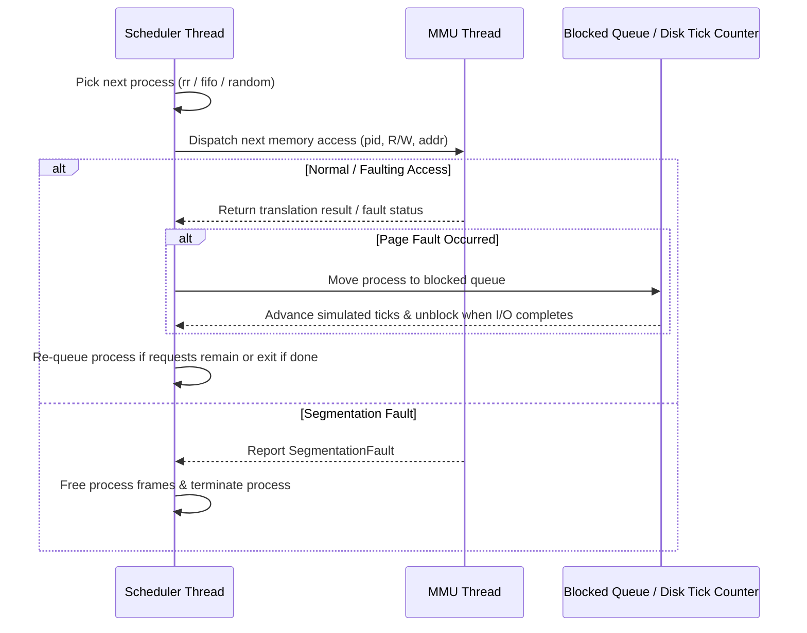

#  Virtual Memory Manager (VMM) Simulator

A multi-threaded, demand-paging virtual memory simulator written in pure **Python 3** with zero external dependencies. An OS-scheduler thread dispatches processes to an MMU thread that translates virtual addresses through an LRU TLB and per-process page tables, raises simulated `SIGUSR1` page faults, blocks faulting processes on simulated disk I/O, and evicts pages using pluggable replacement policies.

---

## Table of Contents

- [Features](#features)
- [Architecture & Execution Flow](#architecture--execution-flow)
- [Usage & CLI Options](#usage--cli-options)
- [Input Format & Workload Generator](#input-format--workload-generator)
- [Timing & Cost Model](#timing--cost-model)
- [Project Structure](#project-structure)
- [Testing](#testing)
- [Key Fixes vs. Original Implementation](#key-fixes-vs-original-implementation)

---

## Features

- **Page replacement algorithms:** `fifo`, `lru`, `lfu`, `clock` (second chance), and `random`.
- **TLB:** Fully associative LRU TLB with invalidation on page eviction and process exit (`--tlb-size 0` disables it).
- **Demand paging:** Tracks present, dirty, and referenced bits; dirty victims incur an extra disk write-back.
- **CPU schedulers:** `rr` (round robin with configurable quantum), `fifo` (run until block or completion), and `random`.
- **Blocked queue & simulated disk I/O:** Faulting processes move to a blocked queue while ready processes continue executing.
- **Deterministic tick clock:** Uses a simulated tick counter rather than `time.sleep`, keeping runs fast and reproducible.
- **Process lifecycle & protection:** Frees frames upon process exit/termination and raises segmentation faults for out-of-range virtual addresses without killing other processes.
- **Configurable hardware & simulation parameters:** Memory size (`K`/`M`/`G` suffixes, any multiple of page size), page size, virtual address width, tick costs, and random seed.
- **Reporting & export:** Tracks faults, TLB/page hit rates, write-backs, average access time, and per-process stats; supports `--compare`, `--stats-json`, and `--trace-csv`.
- **Workload tools & unit tests:** Includes a locality-aware synthetic workload generator, defensive input parser, and `unittest` suite.

---

## Architecture & Execution Flow

### 1. Address Translation & Page Fault Path

```mermaid
flowchart TD
    VA[Virtual Address] --> Bounds{Within Address Space?}
    Bounds -- No --> SegFault[SegmentationFault -> Terminate Process]
    Bounds -- Yes --> TLB{TLB Hit?}
    TLB -- Yes --> HitCost[Cost: tlb + mem]
    TLB -- No --> PT{Page Present in RAM?}
    PT -- Yes --> LoadTLB[Update TLB] --> MissCost[Cost: tlb + 2*mem]
    PT -- No --> Sig[Raise SignalUser1 / Page Fault]
    Sig --> Free{Free Frame Available?}
    Free -- Yes --> DiskIn[Disk Read -> Allocate Frame]
    Free -- No --> Victim[Select Victim via Replacement Policy]
    Victim --> Dirty{Victim Dirty?}
    Dirty -- Yes --> WB[Disk Write-Back + Disk Read]
    Dirty -- No --> DiskIn
    WB --> Inval[Invalidate TLB & Page Table Entry]
    DiskIn --> Inval --> FaultCost[CPU: tlb + 2*mem | Block: disk or 2*disk]
```

### 2. Two-Thread Scheduler & MMU Coordination



---

## Usage & CLI Options

```bash
python main.py <input_file> <memory_size> [options]

python main.py sample_requests.txt 4096 --seed 1 --show-memory
python main.py workload_large.txt 8K -a clock --tlb-size 8 -q
python main.py workload_large.txt 8K --compare --seed 5
python main.py workload_large.txt 8K -a lru --stats-json stats.json --trace-csv trace.csv
```

`memory_size` is specified in bytes and supports `K`, `M`, and `G` suffixes. It must be an exact multiple of `--page-size` (it does not need to be a power-of-two number of frames).

| Option | Default | Description |
| :--- | :--- | :--- |
| `-a, --algorithm` | `lru` | Page replacement policy: `fifo`, `lru`, `lfu`, `clock`, `random` |
| `-s, --scheduler` | `rr` | Scheduling policy: `rr`, `fifo`, `random` |
| `--quantum` | `1` | Number of requests per time slice (for `rr`) |
| `--page-size` | `1024` | Page/frame size in bytes (power of two) |
| `--address-bits` | `16` | Virtual address bit width |
| `--tlb-size` | `4` | Number of TLB entries (`0` disables the TLB) |
| `--tlb-time` | `1` | TLB lookup cost in simulated ticks |
| `--memory-time` | `10` | Physical memory access cost in simulated ticks |
| `--disk-time` | `1000` | Disk I/O cost in simulated ticks |
| `--seed` | random | Seed for reproducible runs |
| `-q, --quiet` | off | Print summary output only |
| `--show-memory` | off | Print frame allocation map after each access |
| `--strict` | off | Abort execution on malformed input lines |
| `--stats-json` | none | Write summary and per-process statistics to a JSON file |
| `--trace-csv` | none | Export per-access execution trace to a CSV file |
| `--compare` | off | Run all replacement algorithms on the same workload |

---

## Input Format & Workload Generator

Input files are comma-separated access traces (`pid,R|W,hex_address`). Blank lines and `#` comments are supported:

```text
# pid,R|W,hex_address
1,R,04A0
2,w,0x0C10
```

Generate a synthetic workload with spatial/temporal locality:

```bash
python generate_workload.py -p 4 -n 100 --locality 0.8 --seed 7 > requests.txt
```

---

## Timing & Cost Model

| Event | Simulated Cost |
| :--- | :--- |
| **TLB hit** | `tlb_time + memory_time` |
| **TLB miss (page resident)** | `tlb_time + 2 * memory_time` |
| **Page fault (clean victim / free frame)** | `tlb_time + 2 * memory_time` CPU ticks + `disk_time` blocking I/O ticks |
| **Page fault (dirty victim write-back)** | `tlb_time + 2 * memory_time` CPU ticks + `2 * disk_time` blocking I/O ticks |

---

## Project Structure

```text
├── main.py                  # CLI entry point and argument handling
├── generate_workload.py     # Synthetic workload generator with locality controls
├── vmm/
│   ├── config.py            # Simulation configuration and parameter validation
│   ├── memory.py            # Page tables, physical frames, TLB integration, MMU fault path
│   ├── replacement.py       # FIFO, LRU, LFU, Clock, and Random eviction policies
│   ├── tlb.py               # Fully associative LRU TLB and invalidation logic
│   ├── scheduler.py         # Ready/blocked queues and scheduling policies
│   ├── simulator.py         # Scheduler and MMU threads, tick clock, lifecycle hand-off
│   ├── stats.py             # Metrics aggregation, comparison output, JSON/CSV exporters
│   ├── workload.py          # Input trace parser and generator helpers
│   ├── exceptions.py        # Custom VMM exceptions (replaces vmmmisc.py)
│   └── utils.py             # Base/address conversion and parsing helpers
└── tests/
    └── test_vmm.py          # Unit test suite (26 tests)
```

---

## Testing

Run the full test suite using Python's built-in `unittest` runner:

```bash
python -m unittest discover -s tests -v
```

---

## Key Fixes vs. Original Implementation

1. **Import safety:** Removed top-level execution on import in `vmm` modules so only `main.py` starts a simulation run.
2. **Process re-queuing:** Re-queued processes after non-faulting accesses as well as faults so multi-request processes do not drop remaining operations.
3. **Clean thread shutdown:** Replaced premature `os._exit(0)` calls with coordinated two-thread hand-off, shutdown signaling, and error propagation.
4. **Physical address width:** Replaced 16-bit truncation with shift-based physical address calculation to prevent frame number overflow.
5. **Page metadata reset:** Cleared stale dirty bits and frame mappings on eviction and avoided marking freshly paged-in frames as dirty.
6. **TLB coherency:** Invalidated stale TLB translations whenever pages are evicted or processes exit.
7. **Frame reclamation:** Freed a process's allocated frames when it completes or encounters a segmentation fault.
8. **Memory size validation:** Replaced `math.log(P, 2)` assumptions with explicit validation supporting non-power-of-two frame counts and `K`/`M`/`G` sizing.
9. **Input & bounds checking:** Handled blank lines, comments, malformed entries, and out-of-bounds virtual addresses instead of silently wrapping or crashing.
10. **Victim selection safety:** Prevented random eviction from picking unallocated frames and separated free-frame lookup from victim selection.
11. **Formatting utilities:** Fixed negative binary padding in `inttobin` and removed `.upper()[2:]` string hacks.
12. **Exception formatting:** Fixed exception `__str__` behavior and spelling typos (`SignalUser1`, `SegmentationFault`, etc.).
13. **Documentation:** Aligned file paths, CLI flags, and behavior descriptions with the actual codebase.
